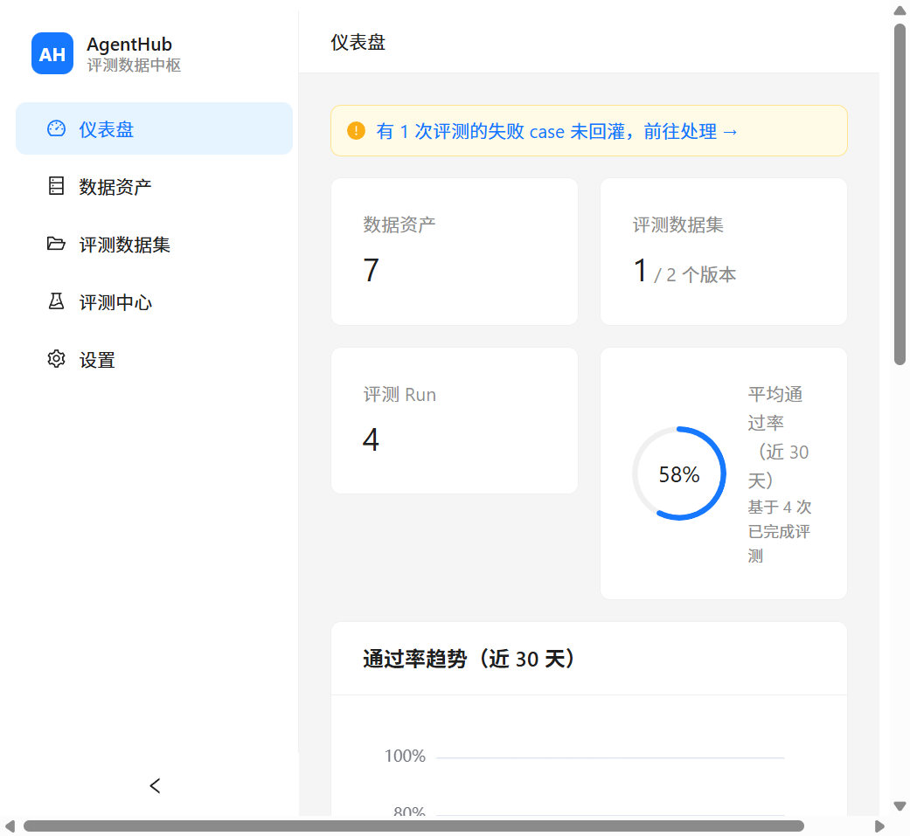
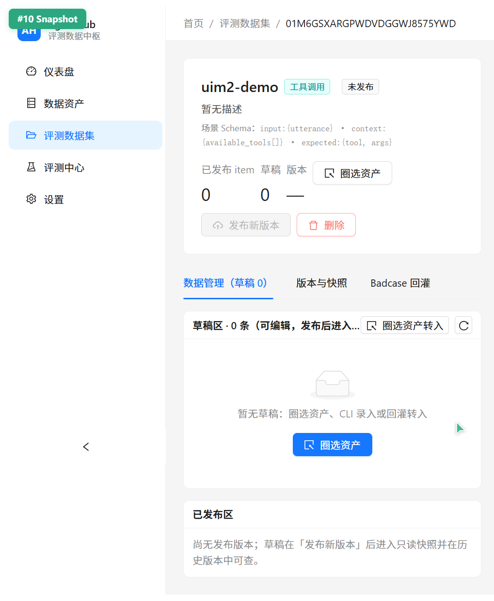
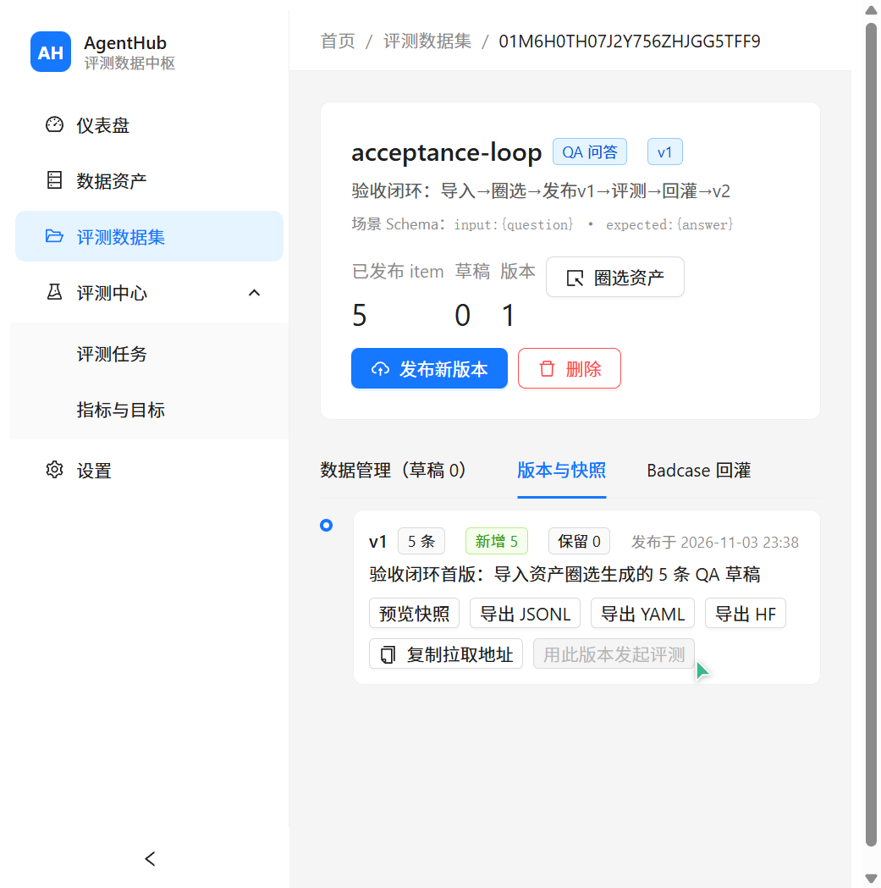
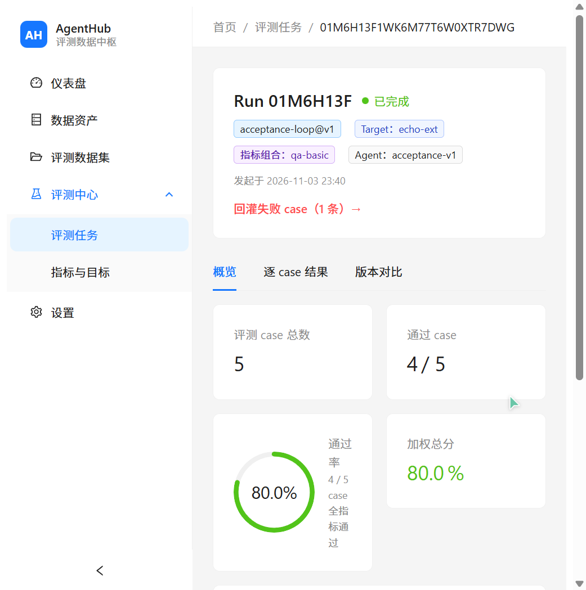
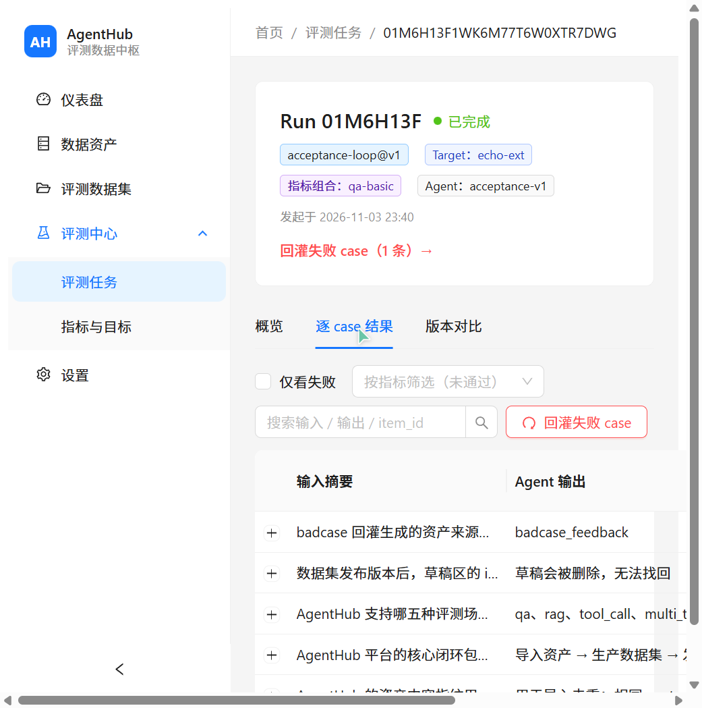
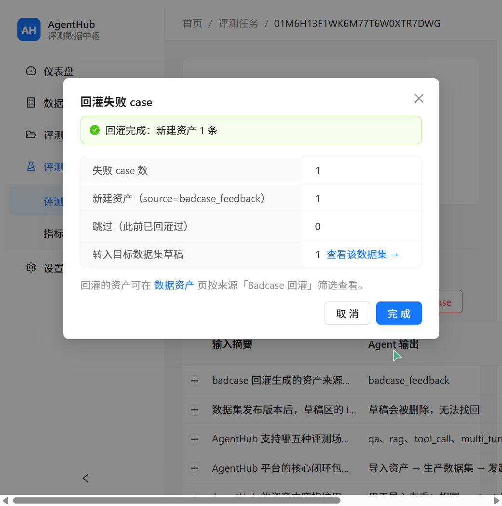
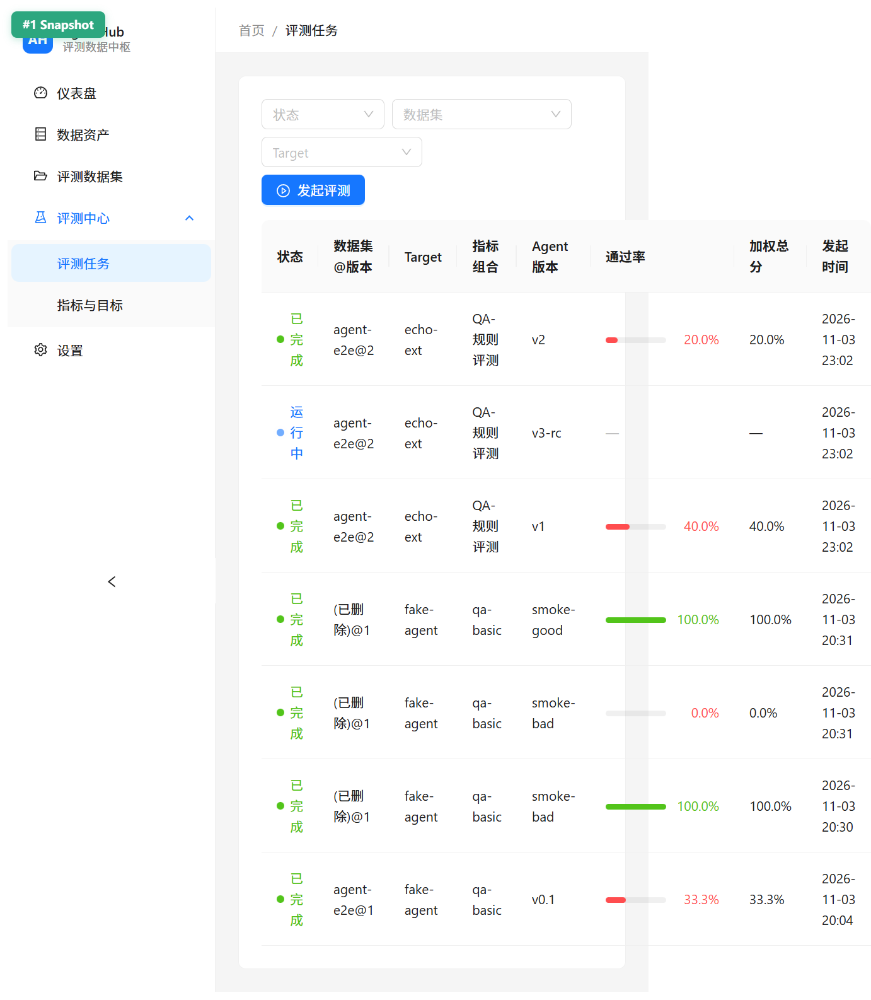
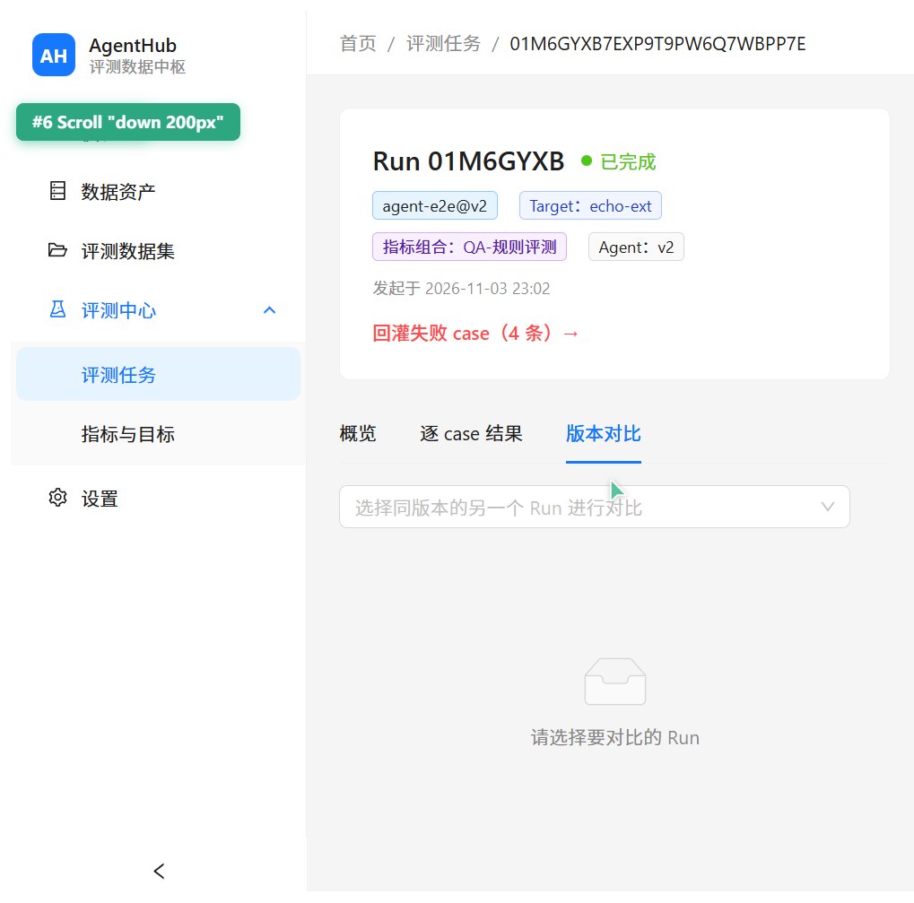
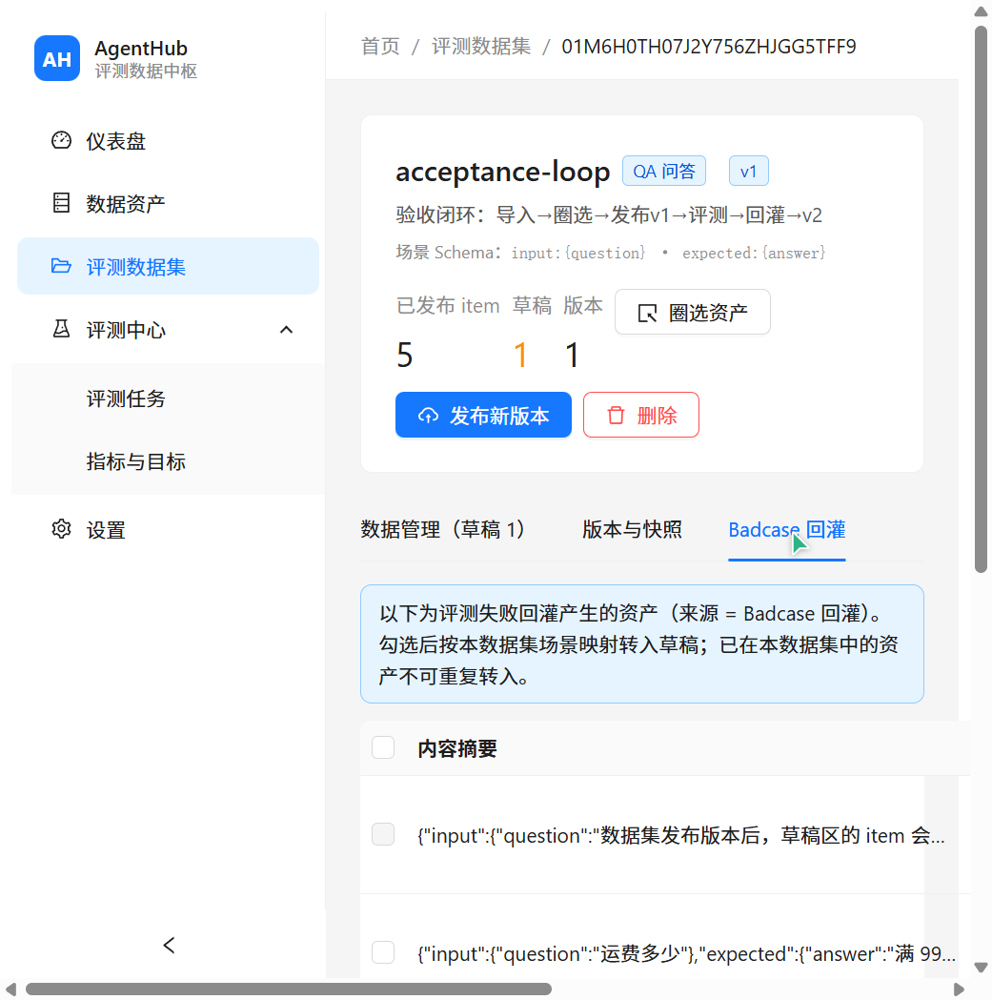
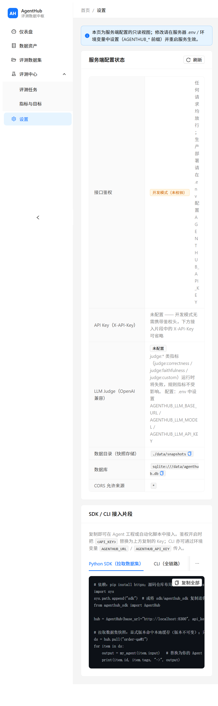

# AgentHub — 面向 Agent 评测的轻量数据中枢

[](https://github.com/xiaoxin8635/agenthub/actions/workflows/ci.yml)

统一管理数据资产 → 标准化生产评测数据集 → 发起评测 → 失败 case 回灌形成闭环。**全流程可在浏览器中完成，无需命令行。**

```
导入资产 ──► 圈选生产数据集 ──► 发布不可变版本 ──► 发起评测（HTTP 托管 / External 回传）
                                                    │
              回灌失败 case ◄── 查看 通过率/逐 case 明细/版本对比 ◄┘
                    │
                    └──► 转入草稿 → 再次发布 → 下一轮回归
```

## 功能特性

| 模块 | 能力 |
|---|---|
| 数据资产 | JSONL 拖拽导入（自动去重指纹）、来源/标签/关键词筛选、内容 JSON 树查看、批量加入数据集 |
| 评测数据集 | 5 种场景 Schema（qa / rag / tool_call / multi_turn / trajectory）、圈选资产向导（映射预览 + 非法自动跳过）、发布不可变版本（changelog + 变更摘要）、版本时间线、快照预览、导出 JSONL/YAML/HF |
| 评测中心 | 4 步发起向导、HTTP 托管执行与 External 回传两种模式、3s 自动轮询、概览指标卡 + 指标分布条形图 + 失败 tag 分布、逐 case 红绿明细、跨 Run 版本对比（回归/修复 case 识别） |
| 失败回灌 | 任意结果页一键回灌失败 case → 沉淀为 `badcase_feedback` 资产（含 agent_output/run 反链）→ 可选直接转入目标数据集草稿 |
| 指标体系 | 规则（exact/contains/json_schema）、LLM Judge（OpenAI 兼容）、RAG、轨迹四类指标目录；MetricConfig 加权组合；加权总分 |
| 控制台 | 中文优先、语义色（绿/黄/红）+ 环形通过率、空态三步引导、设置页展示服务端配置与 SDK/CLI 接入片段 |

## 界面预览

| | |
|---|---|
|  |  |
| *仪表盘：指标卡 + 通过率趋势 + 待办提示* | *数据集详情：草稿/发布/版本时间线/Badcase 回灌* |
|  |  |
| *发布版本：变更摘要 + changelog + 时间线* | *Run 概览：通过率 80%、指标分布、失败 tag 聚合* |
|  |  |
| *逐 case：逐指标红绿分数、仅看失败、一键回灌* | *回灌完成：新建资产 + 转入数据集草稿 + 跳转* |
|  |  |
| *评测任务：状态筛选 + 通过率色条* | *被测目标 / 指标组合 / 指标目录管理* |
|  |  |
| *badcase 资产含 run 反链，勾选转入草稿* | *服务端配置状态 + API Key + SDK/CLI 片段* |

## 技术栈

- **后端**：Python 3.11+ / FastAPI / SQLAlchemy 2 / SQLite（零外部依赖，开箱即用）/ Pydantic v2
- **前端**：React 18 / TypeScript / Vite / Ant Design 5 / ECharts 5
- **SDK**：`agenthub_sdk`（Python，pull 数据集 + 发起评测 + 读结果）
- **测试**：pytest（后端 84 个用例）

## 快速开始

### 1. 后端（端口 8300）

```bash
pip install -r requirements.txt
cp .env.example .env        # 可选：不配置即开发模式（不校验 API Key）
python -m uvicorn agenthub.main:app --port 8300
```

- API 根地址：`http://127.0.0.1:8300/api/v1`
- 健康检查：`GET /api/v1/health`
- 环境变量（见 [.env.example](.env.example)）：`AGENTHUB_DB`、`AGENTHUB_DATA_DIR`、`AGENTHUB_API_KEY`、`AGENTHUB_LLM_BASE_URL/KEY/MODEL`（仅 LLM Judge 需要）、`AGENTHUB_RUN_CONCURRENCY`（托管评测并发数）、`AGENTHUB_RUN_RETRY`（case 网络失败重试次数）、`AGENTHUB_WEBHOOK_URL`（评测完成事件推送）

### Docker 一键部署

```bash
docker compose up -d --build
# 打开 http://localhost:8080（nginx 托管前端并反代 /api）
# 数据落在命名卷 agenthub-data（SQLite + 版本快照）
```

### 2. Web 控制台（端口 5173）

```bash
cd web
npm install
npm run dev     # 打开 http://localhost:5173
```

开发模式下 vite 将 `/api` 代理到 8300。生产构建：`npm run build`（产物 `dist/`，可由 FastAPI 静态托管实现单服务部署）。

### 3. 运行测试

```bash
pytest          # 后端 84 个用例
cd web && npx tsc --noEmit   # 前端类型检查
```

### 4. 导入第一批数据

控制台 → 数据资产 → 「导入资产」→ 拖入 JSONL（每行 `{"type": "custom", "content": {...}}`），或：

```bash
curl -F file=@data.jsonl -F source=trace_import -F tags=smoke \
  http://127.0.0.1:8300/api/v1/assets/import
```

> 详细使用文档（控制台全流程 / External 回传协议 / CLI / SDK / FAQ）见 [docs/07-启动与使用指南](docs/07-启动与使用指南.md)。

## SDK 用法

```python
from agenthub_sdk import AgentHub

hub = AgentHub(base_url="http://localhost:8300", api_key="")
ds = hub.pull("order-agent-regression@3")   # 拉取不可变快照（本地缓存）

for item in ds:                              # Item(id, input, expected, context, ...)
    output = my_agent(item.input)
    compare(output, item.expected)
```

> SDK 定位为数据集拉取客户端；发起评测 / 回灌请用控制台、CLI（`python -m agenthub.cli eval ...`）或 REST API。

## API 概览

| 分组 | 端点 | 说明 |
|---|---|---|
| 资产 | `POST /assets/import` | JSONL 导入（multipart，自动指纹去重） |
| | `GET /assets?type=&source=&tag=&q=` | 分页筛选 |
| 数据集 | `POST /datasets` · `POST /datasets/{id}/items/from-assets` | 建集 / 圈选转入草稿 |
| | `POST /datasets/{name}/versions` | 发布版本（写不可变快照） |
| | `GET /datasets/{name}/versions/{v}/export?format=jsonl\|yaml\|hf` | 快照导出 |
| 评测 | `POST /runs` · `POST /runs/{id}/results` | 发起评测 / External 回传结果（收齐自动聚合） |
| | `GET /runs?status=&dataset=&target=` | Run 摘要（含 pass_rate / weighted_total） |
| 统计 | `GET /stats` | 仪表盘 counts / 30 天趋势 / 待办 |
| 配置 | `GET /settings` · `GET /metrics` | 服务端配置状态 / 指标目录 |

完整定义见 [03-数据模型与API设计](docs/03-数据模型与API设计.md)。

## 目录结构

```
agenthub/            # 后端包：routers / services / metrics / runners / db / schemas
web/                 # React 控制台（Vite + antd 5 + echarts）
sdk/agenthub_sdk/    # Python SDK（数据集拉取，带本地缓存）
docs/                # 设计文档 + 截图
tests/               # pytest 用例
data/                # SQLite 与版本快照（运行时生成，不入库）
```

## 文档索引

| 文档 | 内容 |
|---|---|
| [00-需求文档](docs/00-需求文档.md) | 需求基线（as-built）：FR/NFR 编号、验收标准、格式规范 |
| [01-项目概述](docs/01-项目概述.md) | 定位、痛点、目标/非目标、用户故事、里程碑 |
| [02-架构设计](docs/02-架构设计.md) | 总体架构、技术选型、模块设计、关键决策 |
| [03-数据模型与API设计](docs/03-数据模型与API设计.md) | ER 图、表结构、Item Schema、REST API、SDK/CLI |
| [04-评测指标体系](docs/04-评测指标体系.md) | 规则/LLM Judge/RAG/轨迹四类指标、聚合与对比 |
| [05-参考项目调研](docs/05-参考项目调研.md) | Langfuse/promptfoo/DeepEval/RAGAS 等借鉴与差异定位 |
| [06-前端UI需求文档](docs/06-前端UI需求文档.md) | AgentHub Console：站点地图、页面需求 UI-1xx~5xx、视觉规范 |
| [07-启动与使用指南](docs/07-启动与使用指南.md) | 安装启动、配置参考、控制台全流程、External 回传协议、CLI/SDK/API 速查、FAQ |

## 项目状态

- ✅ M1-M5 后端全量交付（84 测试通过）：资产/数据集/版本快照/评测引擎/回灌与对比
- ✅ UI-M1~M4 控制台四期交付并通过全闭环浏览器实测：导入 → 建集圈选 → 发布 v1 → 发起评测 → 看结果 → 回灌 → 发布 v2 全程无命令行
