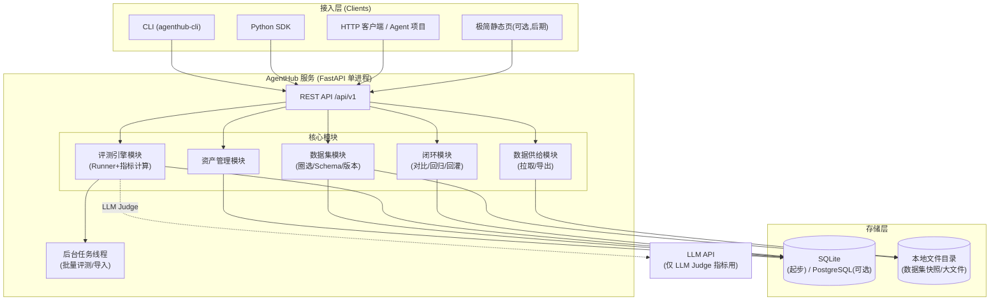

# 02 架构设计

## 1. 总体架构

单进程单体服务，五层结构，每层只依赖下一层：



## 2. 技术选型

| 项 | 选型 | 理由 |
|---|---|---|
| 语言/框架 | Python 3.11+ / FastAPI | 与评测生态（DeepEval/RAGAS）同语言；自动生成 OpenAPI |
| ORM | SQLAlchemy 2.0 + Alembic | 迁移可管理，SQLite/PG 可切换 |
| 数据库 | SQLite（默认）→ PostgreSQL（可选） | 零运维起步；评测数据量级（万级 Items、十万级 Results）SQLite 足够 |
| 数据校验 | Pydantic v2 | Item Schema / API 契约统一用它定义 |
| 后台任务 | 内置 `asyncio` 任务 + 线程池（不引入 Celery/Redis） | 评测是批量长任务，单机够用 |
| CLI | Typer | 与 FastAPI 同作者，风格一致 |
| SDK | 纯 `httpx` 封装，发布为 wheel | Agent 项目 `pip install agenthub-sdk` |
| LLM Judge | OpenAI 兼容接口（可指向任意网关/本地模型） | 不绑定厂商 |
| 导出格式 | JSONL / YAML（promptfoo 兼容）/ HF `datasets` | 覆盖三种主流消费方式 |

## 3. 模块设计

### 3.1 资产管理模块（Asset）

- **职责**：原始数据（对话记录、agent trace、工具日志、文档语料）的进入与治理。
- **入口**：单条上传、批量 JSONL 导入、OpenAI 兼容 trace 导入（借鉴 Langfuse 的 trace 模型，但只存关键字段）。
- **治理**：标签体系（扁平 tag，无层级）、内容 hash 去重、来源标记（`manual` / `trace_import` / `badcase_feedback`）。
- **不做**：全文检索（用 SQLite LIKE 即可）、血缘分析。

### 3.2 数据集模块（Dataset）

- **职责**：资产 → 标准评测数据集的生产线。
- **场景模板**（决定 Item Schema）：
  - `qa`：单轮问答（input + expected_answer）
  - `rag`：检索增强（question + context + expected_answer）
  - `tool_call`：工具调用（input + available_tools + expected_tool + expected_args）
  - `multi_turn`：多轮对话（turns[] + expected_final）
  - `trajectory`：Agent 完整轨迹（task + expected_outcome + 轨迹约束）
- **版本化**：Dataset 是「名」，DatasetVersion 是不可变快照（借鉴 promptfoo 的 tests 文件不可变思想）；发布 v3 后 v3 永不改动，修正只能发 v4。
- **快照文件**：每个版本落一份 JSONL 快照到本地文件目录，DB 只存元数据与统计（条数、tag 分布）——文件即真相，便于 diff 和 git 管理。

### 3.3 数据供给模块（Supply）

- `GET /datasets/{name}/versions/{version}/items?format=jsonl`：分页拉取
- `GET /datasets/{name}/versions/{version}/export?format=hf|yaml`：整包下载
- SDK 侧 `agenthub.pull("name@version")` 带本地缓存（etag）。
- 供给的是**快照**，Agent 项目永远拿到确定性的数据（可复现评测的前提）。

### 3.4 评测引擎模块（Eval）

两种执行模式（借鉴 Langfuse 的 experiments + DeepEval 的本地执行）：

- **托管模式**：注册 EvalTarget（Agent 的 HTTP endpoint + 适配配置），AgentHub Runner 逐条调用、采集输出与轨迹、算分。
- **回传模式**：Agent 项目自己跑，只把结果 POST 回来（`POST /runs/{id}/results`），AgentHub 负责算分/存分——适配任意语言写的 Agent。

指标计算器分四类（详见 [04-评测指标体系.md](./04-评测指标体系.md)）：规则类（纯函数）、语义类（LLM Judge）、RAG 类、轨迹类。指标注册为插件，`MetricRegistry` 按名加载。

### 3.5 闭环模块（Loop）

- **分数矩阵**：`dataset_version × agent_version × metric` 的分数表与趋势。
- **回归检测**：两个 Run 逐 Item 对比，标出「由过转败」的 case。
- **badcase 回灌**：失败 Item 一键生成新 Asset（`source=badcase_feedback`），进入下一轮生产——这是与 Langfuse 最大的差异点：Langfuse 止步于结果展示，我们把「结果 → 数据」的回路做成一等公民。

## 4. 工程结构（规划）

```
DataPlatform/
├── docs/                      # 本文档
├── agenthub/                  # 服务端包
│   ├── main.py                # FastAPI 入口
│   ├── config.py
│   ├── db/                    # SQLAlchemy models + 迁移
│   ├── routers/               # assets / datasets / supply / runs / metrics
│   ├── services/              # 业务逻辑
│   ├── metrics/               # 指标插件
│   │   ├── rule_based.py      # exact/contains/regex/json_schema...
│   │   ├── llm_judge.py       # G-Eval 风格评分
│   │   ├── rag.py             # faithfulness / context_precision...
│   │   └── trajectory.py      # 工具选择/步数/时延...
│   └── runners/               # 托管执行器
├── sdk/                       # agenthub-sdk（独立 wheel）
│   └── agenthub_sdk.py        # pull / run / report
├── cli/                       # Typer CLI
├── data/                      # SQLite + 快照文件（gitignore）
└── tests/
```

## 5. 关键设计决策

| 决策 | 选择 | 放弃的方案 | 原因 |
|---|---|---|---|
| 部署形态 | 单进程 + SQLite | docker-compose 五件套（Langfuse 式） | 目标是单人研发环境，运维成本归零 |
| 数据集真相 | 快照文件 + DB 元数据 | 纯 DB 行存储 | 文件可 diff、可 git、可直接被脚本消费 |
| 评测执行 | 托管 + 回传双模式 | 仅托管 | Agent 可能是任意语言/框架，回传模式保证不锁定 |
| LLM Judge | OpenAI 兼容接口 | 内置多个厂商 SDK | 一个适配点，用户自己指向网关/本地模型 |
| 权限 | 单 API Key（.env 配置） | RBAC/多租户 | 非目标，砍掉 |
| 任务队列 | asyncio + 线程池 | Celery + Redis/Broker | 评测是分钟级批任务，不是秒级高并发 |

## 6. 部署与运行

```bash
# 开发运行
uvicorn agenthub.main:app --reload --port 8300

# 配置（.env）
AGENTHUB_DB=sqlite:///data/agenthub.db
AGENTHUB_DATA_DIR=./data/snapshots
AGENTHUB_API_KEY=<任意字符串>
AGENTHUB_LLM_BASE_URL=<openai兼容地址>   # 仅 LLM Judge 需要
AGENTHUB_LLM_API_KEY=<key>
AGENTHUB_LLM_MODEL=<model name>
```

后期若数据量增长（>百万 Result 行），仅需把 `AGENTHUB_DB` 切到 PostgreSQL 连接串并跑一次迁移，代码零改动。
