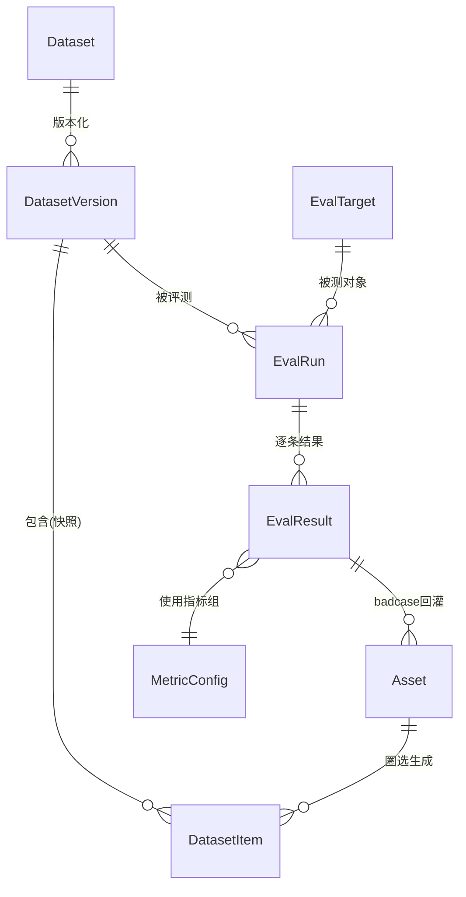

# 03 数据模型与 API 设计

## 1. 实体关系



## 2. 核心表结构

### Asset（数据资产）

| 字段 | 类型 | 说明 |
|---|---|---|
| id | ULID | 主键 |
| type | enum | `dialog` / `trace` / `tool_log` / `doc` / `custom` |
| source | enum | `manual` / `trace_import` / `badcase_feedback` |
| content | JSON | 原始内容（结构化 JSON） |
| content_hash | string | 去重指纹（sha256 of canonical json） |
| tags | JSON | 扁平标签数组 `["订单","失败case"]` |
| meta | JSON | 自由扩展（模型名、时间、来源系统等） |
| created_at | datetime | |

### Dataset / DatasetVersion / DatasetItem

| 表 | 关键字段 | 说明 |
|---|---|---|
| Dataset | id, name(唯一), scene, description | 数据集「名」，scene 决定 Schema 模板 |
| DatasetVersion | id, dataset_id, version(int), snapshot_path, item_count, stats(JSON), status | 不可变快照；发布后只读 |
| DatasetItem | id, version_id, source_asset_id(可空), input(JSON), expected(JSON), context(JSON), tags(JSON) | 核心记录 |

**Item Schema 按场景模板**（Pydantic 定义，入库前强校验）：

```jsonc
// qa
{ "input": {"question": "..."}, "expected": {"answer": "..."} }

// rag
{ "input": {"question": "..."}, "context": {"passages": ["..."]}, "expected": {"answer": "..."} }

// tool_call
{ "input": {"utterance": "帮我查A1002的订单"},
  "context": {"available_tools": ["query_order", "cancel_order"]},
  "expected": {"tool": "query_order", "args": {"order_id": "A1002"}} }

// trajectory（Agent 端到端）
{ "input": {"task": "..."},
  "context": {"available_tools": [...], "max_steps": 10},
  "expected": {"outcome": "订单已取消", "must_call_tools": ["cancel_order"], "must_not_call_tools": ["refund"]} }
```

### EvalTarget / EvalRun / EvalResult

| 表 | 关键字段 | 说明 |
|---|---|---|
| EvalTarget | id, name, kind(`http`/`external`), endpoint_config(JSON) | 被测 Agent；`external` 表示回传模式 |
| MetricConfig | id, name, scene, metrics(JSON) | 指标组合，如 `[{"type":"rule:exact","field":"expected.answer"},{"type":"llm_judge","rubric":"..."}]` |
| EvalRun | id, dataset_version_id, target_id, metric_config_id, status(`pending/running/done/failed`), summary(JSON 聚合分), agent_version(自由标注如 "v1.2-prompt-b") | 一次评测 |
| EvalResult | id, run_id, item_id, output(JSON), trajectory(JSON), scores(JSON `{"exact":0,"judge":0.82}`), passed(bool), error(str) | 逐 Item 结果 |

## 3. REST API（/api/v1，as-built）

> **实时接口文档**：服务启动后访问 `http://localhost:8300/docs`（Swagger UI）或 `/openapi.json`，随代码自动同步，参数/响应模型以那里为准。本节是按模块分组的速查清单。

所有请求带 `X-API-Key` 头（服务端 `AGENTHUB_API_KEY` 为空时放行）。统一响应 `{code, data, error}`。CORS 由 `AGENTHUB_CORS_ORIGINS` 控制（默认 `*`）。路径中的数据集 id 均可替换为数据集名。

### 资产

```
POST   /assets                                # 单条创建（content 重复 → 409）
POST   /assets/import                          # JSONL 批量导入（multipart：file + Form source/tags，逗号分隔）
GET    /assets?type=&source=&tag=&q=&offset=&limit=   # 列表（q 中文 LIKE，返回 total）
GET    /assets/{id}
PATCH  /assets/{id}                            # 改 tags/meta（content 不可变）
DELETE /assets/{id}
```

### 数据集

```
POST   /datasets                                      # 建数据集（name 唯一，scene ∈ 5 场景）
GET    /datasets?scene=
GET    /datasets/{id}                                 # 概览（id 或 name）
DELETE /datasets/{id}                                 # 级联删草稿；已发布版本快照保留
POST   /datasets/{id}/items                           # 手工添加草稿 item（skip_invalid 容错）
POST   /datasets/{id}/items/from-assets               # 圈选资产转草稿（asset_ids 或 filters + tags + skip_invalid）
GET    /datasets/{id}/items?draft=&version=&offset=&limit=
DELETE /datasets/{id}/items/{item_id}                 # 仅草稿可删
POST   /datasets/{id}/versions                        # 发布（body: {changelog}）→ version=N，快照落盘
GET    /datasets/{id}/versions                        # 版本列表（version 降序）
GET    /datasets/{name}/versions/{N}/export?format=jsonl|yaml|hf   # 整包下载
```

### 供给

```
GET    /supply/datasets/{name}/resolve                # 最新版本解析（latest_version/scene/item_count）
GET    /supply/datasets/{name}/latest                 # 302 → 最新版本 JSONL（CI 可写死 URL）
```

### 评测与闭环

```
GET    /metrics                                       # 注册指标目录（type/kind/description）
POST   /targets                                       # 注册被测 Agent（kind=http 需 endpoint_config.url）
GET    /targets
POST   /metric-configs                                # 指标组合（scene + 指标列表，未知类型 422）
GET    /metric-configs

POST   /runs                                          # 发起评测 {dataset_version_id, target_id, metric_config_id, agent_version}
GET    /runs?status=&dataset=&target=&offset=&limit=  # Run 摘要列表（dataset/target 支持 id 或名称）
POST   /runs/{id}/start                               # 托管模式：后台 Runner 执行，完成自动聚合
POST   /runs/{id}/results                             # 回传模式：批量提交（幂等，收齐自动聚合）
POST   /runs/{id}/finalize                            # 回传模式：未收齐时强制出分
GET    /runs/{id}                                     # 状态 + summary（含 failed_tags 失败 tag 分布）
GET    /runs/{id}/results?passed=&offset=&limit=      # 逐条结果
POST   /runs/{id}/feedback                            # 失败 case 回灌（body: {dataset?, tags[]}）→ 资产 + 可选入草稿
GET    /runs/{id}/compare/{other_run_id}              # 对比：指标差值 + regressions/fixed + weighted delta
```

### 统计（控制台仪表盘）

```
GET    /stats                                         # counts / trend_30d / draft_datasets / unfeedback_runs
```

> 时间戳统一 UTC 存储，前端负责本地化。

## 4. Python SDK 用法（目标形态）

```python
from agenthub_sdk import AgentHub

hub = AgentHub(base_url="http://localhost:8300", api_key="...")

# 1. 拉数据集（本地缓存，版本不变不重复下载）
ds = hub.pull("order-agent-regression@3")

# 2a. 回传模式：Agent 项目自己跑完上报
run = hub.create_run(dataset="order-agent-regression@3",
                     target="order-agent", agent_version="v1.3")
for item in ds:
    output = my_agent(item.input)
    run.report_result(item, output=output, trajectory=output.steps)
run.finalize()   # 服务端统一算分

# 2b. 托管模式：只提供 endpoint，AgentHub 调用+算分
run = hub.run_eval(dataset="order-agent-regression@3",
                   endpoint="http://localhost:9000/invoke",
                   metric_config="agent-e2e-v1")
print(run.summary)  # {"success_rate": 0.87, "tool_accuracy": 0.93, ...}
```

## 5. CLI 用法（目标形态）

```bash
agenthub asset import traces.jsonl --tag 线上trace
agenthub dataset create order-regression --scene trajectory
agenthub dataset publish order-regression --changelog "补充17条取消订单case"
agenthub dataset export order-regression@3 -f yaml -o ./eval/tests.yaml   # promptfoo 兼容
agenthub run start order-regression@3 --target order-agent --metrics agent-e2e-v1
agenthub run compare 12 15
agenthub badcase feedback 15 --tag 待复核
```
