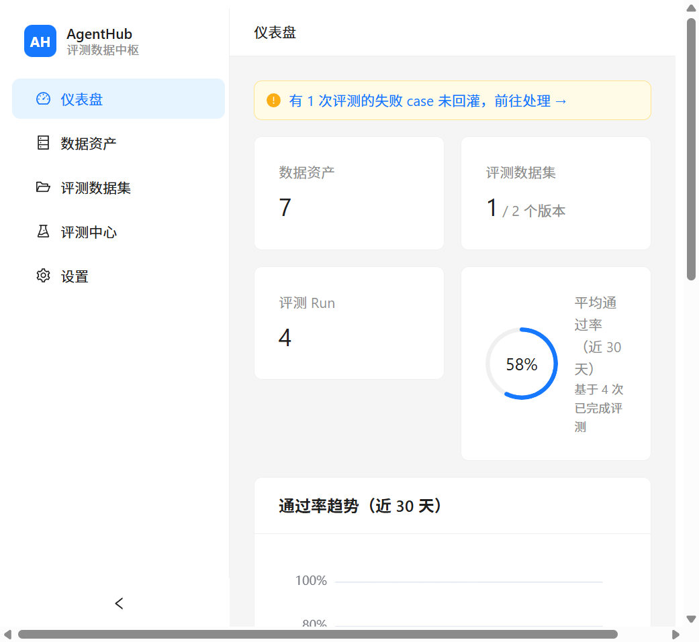
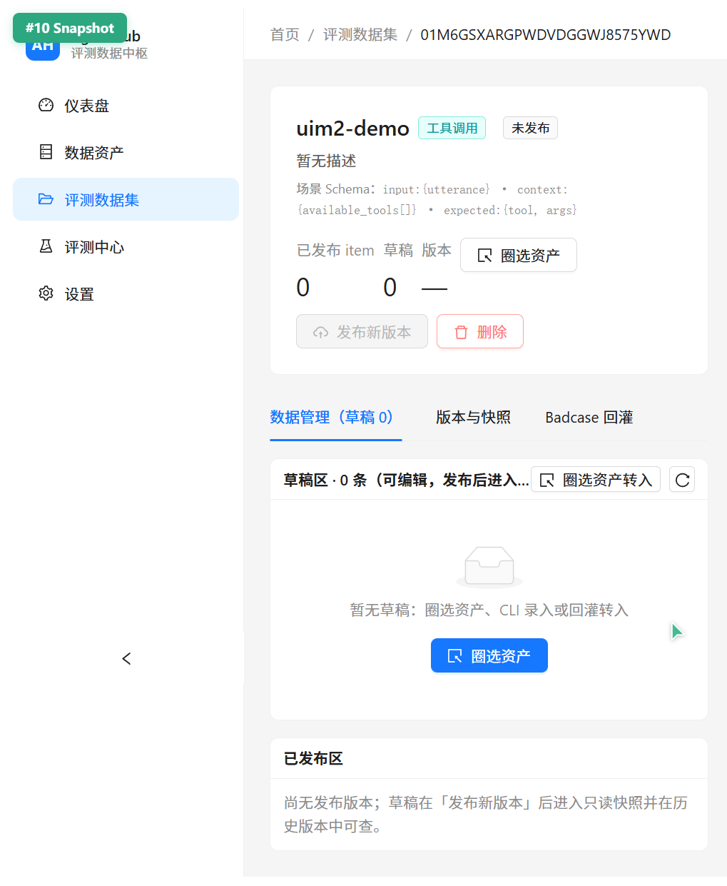
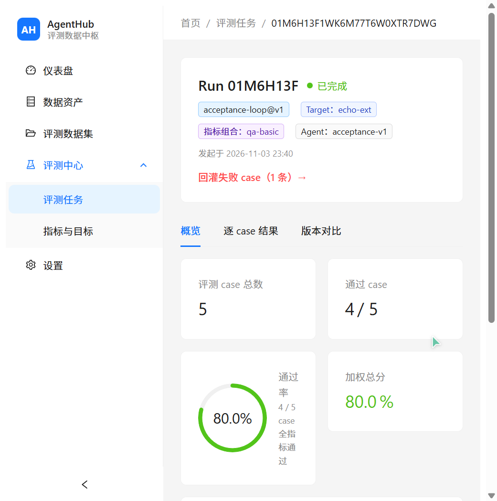
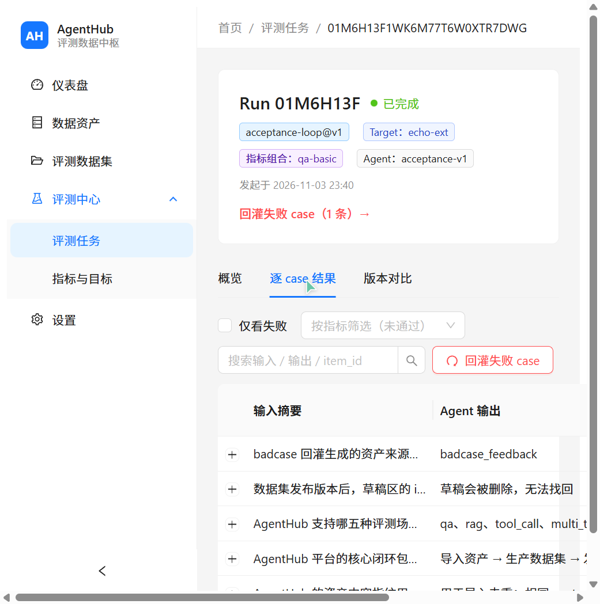
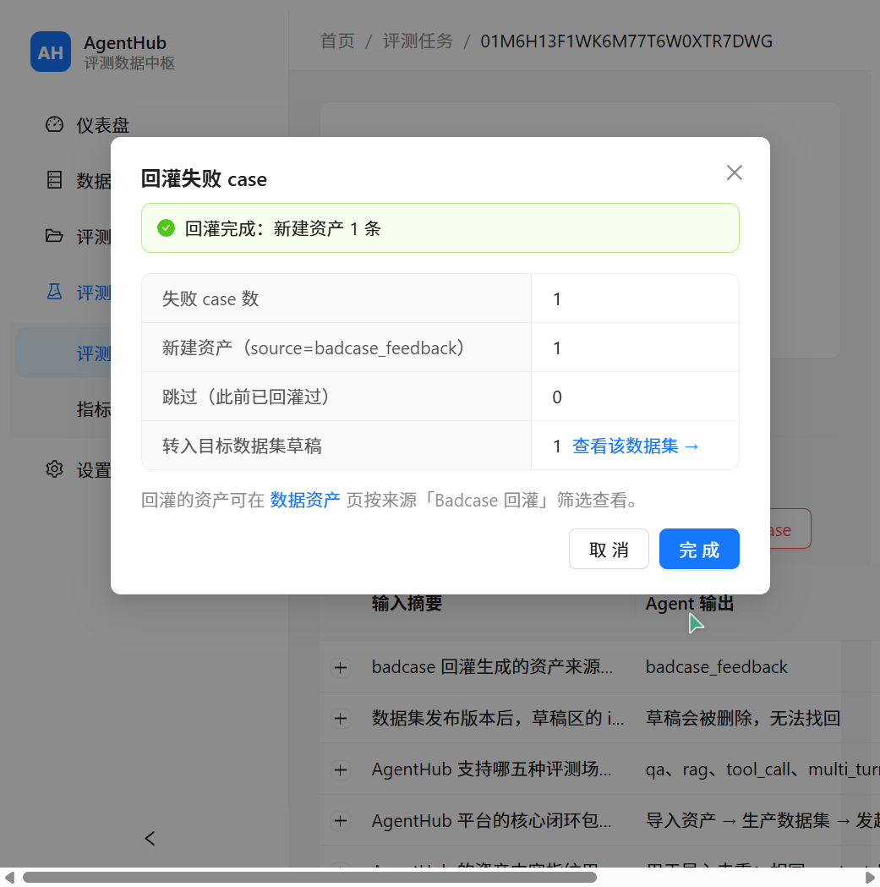
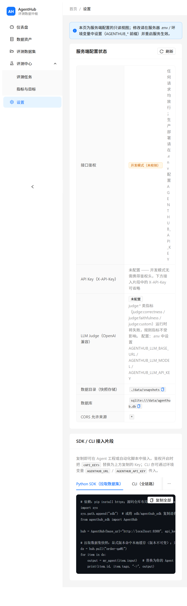

# 07 启动与使用指南

> 面向使用者的完整操作手册：环境准备 → 服务启动 → Web 控制台全流程使用 → CLI / SDK / API 进阶 → 常见问题。
> 设计背景与需求基线见 [00-需求文档](./00-需求文档.md)，本文档只关心「怎么跑起来、怎么用」。

## 目录

- [1. 整体架构](#1-整体架构)
- [2. 环境要求](#2-环境要求)
- [3. 安装与启动](#3-安装与启动)
- [4. 配置参考](#4-配置参考)
- [5. Web 控制台使用指南](#5-web-控制台使用指南)
- [6. 场景 Schema 与指标目录](#6-场景-schema-与指标目录)
- [7. External Target 回传协议](#7-external-target-回传协议)
- [8. CLI 参考](#8-cli-参考)
- [9. SDK 参考](#9-sdk-参考)
- [10. REST API 速查](#10-rest-api-速查)
- [11. 常见问题与故障排查](#11-常见问题与故障排查)

---

## 1. 整体架构

```
┌────────────────────────────┐
│  Web 控制台 (React :5173)   │  浏览器完成全部闭环操作
└─────────────┬──────────────┘
              │ /api 代理（开发模式 vite proxy）
┌─────────────▼──────────────┐     ┌──────────────────┐
│  AgentHub API (FastAPI :8300)│────►│  被测 Agent 服务   │
│  assets / datasets / runs    │     │ (HTTP Target 调用) │
│  metrics / stats / settings  │     └──────────────────┘
└─────────────┬──────────────┘
              │
   ┌──────────▼──────────┐   ┌───────────────────────┐
   │ SQLite (data/*.db)   │   │ 版本快照 (data/snapshots)│
   └─────────────────────┘   └───────────────────────┘

  SDK (agenthub_sdk) / CLI (python -m agenthub.cli) 走同一套 REST API
  External Target：由外部系统跑完后 POST /runs/{id}/results 回传
```

三大组件：

| 组件 | 目录 | 说明 |
|---|---|---|
| 后端 API | `agenthub/` | FastAPI 单进程 + SQLite，零外部服务依赖 |
| Web 控制台 | `web/` | React 18 + Ant Design 5，开发模式由 vite 托管 |
| SDK / CLI | `sdk/` + `agenthub/cli.py` | 供 Agent 项目与自动化脚本接入 |

## 2. 环境要求

| 依赖 | 版本 | 说明 |
|---|---|---|
| Python | ≥ 3.11 | 开发实测 3.13；需支持 `X | Y` 联合类型语法 |
| Node.js | ≥ 18 | vite 6 要求；前端仅在开发/构建控制台时需要 |
| 操作系统 | 不限 | Windows / macOS / Linux 均可（Windows 注意 UTF-8，见 [FAQ](#11-常见问题与故障排查)） |

## 3. 安装与启动

### 3.1 后端（端口 8300）

```bash
# 1) 安装依赖（建议虚拟环境）
pip install -r requirements.txt

# 2) 可选：配置环境变量（不配置 = 开发模式，不校验 API Key）
cp .env.example .env

# 3) 启动
python -m uvicorn agenthub.main:app --port 8300
```

启动后自动建表（`data/agenthub.db`）与快照目录（`data/snapshots/`）。验证：

```bash
curl http://127.0.0.1:8300/api/v1/health
# {"code":0,"data":{"status":"up"}}
```

所有业务 API 返回统一包装 `{"code": 0, "data": ...}`；错误返回 `{"code": 非0, "error": {"message": ...}}`。

### 3.2 Web 控制台（端口 5173）

```bash
cd web
npm install
npm run dev        # 开发模式，打开 http://localhost:5173
```

- 开发模式下 vite 将 `/api` 请求代理到 `http://127.0.0.1:8300`（见 `web/vite.config.ts`）。
- 生产构建：`npm run build`（先跑 `tsc --noEmit` 类型检查），产物在 `web/dist/`。
- **部署说明**：当前仓库未内置 FastAPI 静态托管，构建产物可用 nginx / `npx serve dist` 等任意静态服务器托管，并将 API 请求反向代理到 8300。

### 3.3 运行测试

```bash
pytest                        # 后端 84 个用例（不依赖运行中的服务）
cd web && npx tsc --noEmit    # 前端类型检查
```

## 4. 配置参考

后端通过前缀 `AGENTHUB_` 的环境变量或项目根目录 `.env` 文件配置（见 [.env.example](../.env.example)）：

| 变量 | 默认值 | 说明 |
|---|---|---|
| `AGENTHUB_DB` | `sqlite:///data/agenthub.db` | SQLAlchemy 连接串，默认 SQLite |
| `AGENTHUB_DATA_DIR` | `./data/snapshots` | 版本快照落盘目录（JSONL/YAML/HF） |
| `AGENTHUB_API_KEY` | 空 | 留空 = 开发模式不鉴权；设置后所有 `/api/v1/*` 请求需带 `X-API-Key` 头 |
| `AGENTHUB_LLM_BASE_URL` | 空 | LLM Judge 用 OpenAI 兼容接口地址（仅 judge 类指标需要） |
| `AGENTHUB_LLM_API_KEY` | 空 | 对应 API Key |
| `AGENTHUB_LLM_MODEL` | 空 | 模型名，如 `gpt-4o-mini` |
| `AGENTHUB_CORS_ORIGINS` | `*` | 逗号分隔来源白名单，供跨域前端调用 |
| `AGENTHUB_RUN_CONCURRENCY` | `4` | 托管评测并发数：同时调用被测 Agent 的线程数（实测 60 case × 300ms 延迟：串行 19.1s → 并发 4 为 4.9s） |

CLI 额外识别：`AGENTHUB_URL`（默认 `http://localhost:8300`）、`AGENTHUB_API_KEY`。

> LLM Judge 未配置时：含 judge 指标的评测中该指标记为 N/A（不参与通过判定），Run 仍可完成。

## 5. Web 控制台使用指南

左侧导航五个模块：**仪表盘 / 数据资产 / 评测数据集 / 评测中心（评测任务、指标与目标）/ 设置**。核心闭环全部在浏览器内完成：

**导入资产 → 创建数据集并圈选 → 发布版本 → 发起评测 → 查看结果 → 回灌失败 case → 再发布**

### 5.1 仪表盘

- 顶部指标卡：资产总数、数据集数（含版本总数）、评测 Run 数、近 30 天平均通过率（环形）。
- 通过率趋势折线图（按天聚合）、最近 10 条 Run 列表。
- 待办提示条：「有草稿未发布的数据集」「有失败 case 未回灌的 Run」，点击直达。



### 5.2 数据资产管理

**导入（UI-202）**：数据资产页 → 「导入资产」→ 三步向导：

1. 拖入或选择 JSONL 文件；
2. 选择来源（`trace_import` / `manual` / `badcase_feedback`）并输入标签；
3. 查看逐行结果（created / skipped / errors）。

**JSONL 格式**：每行一个 JSON 对象，`type` + `content` 必填：

```jsonl
{"type": "custom", "content": {"input": {"question": "退货政策是什么"}, "expected": {"answer": "7 天无理由退货"}, "context": {}}}
{"type": "custom", "content": {"question": "发货要多久", "answer": "48 小时内"}}
```

- 推荐写法是第一种**结构化直通格式**（`input` / `expected` / `context`），可被任意场景数据集圈选。
- 第二种扁平格式走场景字段名启发式提取（qa：`question`/`answer`）。
- 相同内容指纹的行自动跳过（`skipped`），不产生重复资产。

**列表与筛选**：类型 / 来源 / 标签 / 关键词四个筛选器（防抖 300ms），分页 20/页。资产详情抽屉支持 JSON 树查看、标签就地增删、删除（输入名称确认）。

**批量圈选联动**：列表勾选多条 → 浮出「加入数据集…」→ 选目标数据集，即按其场景映射转入草稿。

### 5.3 评测数据集生产

**创建**：评测数据集页 → 「创建数据集」→ 名称（用于导出地址与 SDK 拉取，如 `order-qa`）+ 场景单选 + 描述。五种场景见 [第 6 节](#6-场景-schema-与指标目录)。

**圈选资产转入草稿（UI-304）**：数据集详情 → 「圈选资产」→ 三步向导：

1. 按类型 / 来源 / 标签 / 关键词筛选资产并勾选（已被本数据集收录的资产禁选）；
2. 预览映射结果、可选附加标签；
3. 查看结果（转入 / 无法映射 / 重复跳过计数）。

无法通过场景 Schema 校验的资产自动跳过并给出原因。

**草稿区与已发布区（UI-303）**：草稿可编辑、删除；已发布 item 只读（来自不可变快照）。

**发布版本（UI-305）**：点「发布新版本」→ 弹窗显示变更摘要（新增 N / 保留 carried N）→ 必填 changelog → 确认。发布后草稿写入只读快照，页面自动跳到版本时间线。

**版本时间线（UI-306）**：每个版本支持：

- 预览快照（前 50 条表格）；
- 导出 JSONL / YAML / HF（直接下载）+ 复制拉取地址；
- **用此版本发起评测**（直达评测向导并预选该版本）。

**Badcase 回灌 Tab（UI-307）**：列出全部 `badcase_feedback` 来源资产（含关联 Run 反链），勾选后一键转入本数据集草稿，形成评测闭环。



### 5.4 评测中心

**被测目标（Target）与指标组合（MetricConfig）**：评测中心 → 「指标与目标」页：

- Target：名称 + kind（`http` = 平台托管调用其端点 / `external` = 外部回传）+ endpoint（HTTP 目标填 URL，如 `http://127.0.0.1:9000/agent`）；
- MetricConfig：名称 + 场景 + 指标动态行（类型下拉 → 参数表单 → 权重 / 阈值）；
- 指标目录：只读表格，来自 `GET /api/v1/metrics`。

**发起评测（UI-402）**：评测任务页 → 「发起评测」→ 四步向导：

1. 选数据集版本（数据集下拉 → 版本下拉，默认最新）；
2. 选 Target；
3. 选指标组合（展示指标与权重）；
4. 确认摘要（可选填 Agent 版本号）→ 提交并跳转 Run 详情。

**Run 详情（UI-403/404/405）**三个 Tab：

- **概览**：total / passed / 通过率环形图 / 加权总分；指标分布条形图（每指标平均分 + 样本数，N/A 灰色）；失败 tag 分布表；
- **逐 case 结果**：每行展示输入摘要、Agent 输出、逐指标分数（红绿点）、passed 徽标；支持「仅看失败」、按指标筛选、搜索、行展开查看完整 JSON；工具栏提供「回灌失败 case」；
- **版本对比**：选另一个同版本 Run → 指标差值表（涨绿跌红）+ 回归 case / 修复 case 清单 + 一键回灌回归 case。

`pending` / `running` 状态下页面每 3 秒自动轮询刷新，完成后停止（页面不可见时暂停）。




**失败回灌（UI-406）**：Run 详情任意入口（头部链接、逐 case 工具栏、对比页）→ 「回灌失败 case」对话框：

- 可选附带标签；
- 可选转入目标数据集草稿（默认仅沉淀为资产）；
- 完成后显示 新建资产数 / 跳过数 / 转入数 与跳转链接。

回灌资产 content 包含 `input` / `expected` / `context` / `agent_output` / `error` / `run_id`，可被任意场景数据集重新圈选；重复回灌按内容指纹自动去重。



### 5.5 设置

只读展示服务端配置状态：鉴权是否开启、LLM Judge 配置（密钥打码）、数据目录；并提供当前 API Key 与 SDK / CLI 接入代码片段一键复制。



## 6. 场景 Schema 与指标目录

### 6.1 五种场景（决定 item 校验与资产映射规则）

| 场景 | input | context | expected | 典型用途 |
|---|---|---|---|---|
| `qa` | `{question}` | — | `{answer}` | 单轮问答 |
| `rag` | `{question}` | `{passages[]}` | `{answer}` | 检索增强问答（支持忠实度评测） |
| `tool_call` | `{utterance}` | `{available_tools[]}` | `{tool, args}` | 意图 → 工具与参数 |
| `multi_turn` | `{turns[{role, content}]}` | — | `{final_answer}` | 多轮对话收尾 |
| `trajectory` | `{task}` | `{available_tools[], max_steps}` | `{outcome, must_call_tools[], must_not_call_tools[]}` | 任务级执行与工具约束 |

### 6.2 指标目录（`GET /api/v1/metrics`）

| 类型 | 类别 | 说明 |
|---|---|---|
| `rule:exact` | 规则 | 实际值与期望值精确相等（可忽略大小写） |
| `rule:contains` / `rule:not_contains` | 规则 | 实际值包含 / 不包含期望关键词 |
| `rule:regex` | 规则 | 实际值匹配正则 |
| `rule:one_of` | 规则 | 实际值属于枚举集合 |
| `rule:numeric_within` | 规则 | 数值落在容差范围内 |
| `rule:json_schema` | 规则 | 输出（或其字段）通过 JSON Schema 校验 |
| `judge:correctness` | LLM Judge | 回答与标准答案的事实一致性 |
| `judge:faithfulness` | LLM Judge | 回答是否忠于给定 context（防幻觉） |
| `judge:custom` | LLM Judge | 自定义评分细则（spec.rubric） |

聚合规则：逐 case 全部指标通过才算 passed；`weighted_total` = Σ(指标均分 × 权重) / Σ权重；0~1 分数在 UI 中一律 ×100 显示。

## 7. External Target 回传协议

External Target 适用于 Agent 在外部系统（CI、私有环境、人工坐席）中执行的场景：

1. 创建 kind=`external` 的 Target（无需 endpoint）；
2. 通过 UI 向导或 `POST /api/v1/runs` 发起评测，Run 处于 `pending`；
3. 外部系统按 item 逐条执行后回传结果：

```bash
curl -X POST http://127.0.0.1:8300/api/v1/runs/{run_id}/results \
  -H "Content-Type: application/json" \
  -d '{"results": [
        {"item_id": "<快照中的 item id>", "output": {"answer": "7 天无理由退货"}},
        {"item_id": "<...>", "output": {"answer": "..."}, "error": "可选的错误信息"}
      ]}'
```

4. 收齐全部 item 后**自动 finalize**，响应 `{"received": N, "expected": N, "done": true}`，Run 状态变 `done` 并生成 summary（指标聚合、failed_tags）。

> `item_id` 从快照获取：`GET /api/v1/datasets/{dataset_id}/items?version=N`，或控制台 Run 详情逐 case 表。

## 8. CLI 参考

无需安装，直接以模块方式运行（连接参数 `--base-url` / `--api-key`，默认取环境变量 `AGENTHUB_URL` / `AGENTHUB_API_KEY`）：

```bash
python -m agenthub.cli <子命令> [参数]
```

| 子命令 | 说明 |
|---|---|
| `import FILE [--source S] [--tags T...]` | 导入 JSONL 资产 |
| `dataset-create NAME SCENE [--description D]` | 创建数据集 |
| `dataset-select NAME --filters k=v... [--tags T...]` | 按 filters 圈选资产转入草稿 |
| `dataset-publish NAME [--changelog C]` | 发布新版本 |
| `pull REF [-o OUT]` | 拉取快照（走 SDK，本地缓存），REF 形如 `name` 或 `name@2` |
| `eval DATASET_REF --target T --metrics M [--agent-version V] [--no-wait]` | 发起托管评测（默认阻塞至完成） |
| `run-show RUN_ID [--failures]` | 查看 Run 状态 / summary / 失败明细 |
| `compare RUN_A RUN_B` | 对比两个 Run（回归 / 修复 / 指标差值） |
| `feedback RUN_ID [--dataset NAME] [--tags T...]` | 失败 case 回灌，可选转入数据集草稿 |
| `metrics list` | 列出注册指标 |

**命令行全流程示例**：

```bash
# 生产数据集
python -m agenthub.cli import traces.jsonl --source trace_import --tags v1
python -m agenthub.cli dataset-create order-qa qa
python -m agenthub.cli dataset-select order-qa --filters source=trace_import tag=退款
python -m agenthub.cli dataset-publish order-qa --changelog "首批 50 条"

# 消费与评测
python -m agenthub.cli pull order-qa@1 -o ds.jsonl
python -m agenthub.cli eval order-qa@1 --target fake-agent --metrics order-e2e
python -m agenthub.cli run-show RUN_ID --failures
python -m agenthub.cli compare RUN_OLD RUN_NEW

# 闭环
python -m agenthub.cli feedback RUN_ID --dataset order-qa --tags regression
python -m agenthub.cli dataset-publish order-qa --changelog "回灌修复回归"
```

## 9. SDK 参考

`sdk/agenthub_sdk/`（当前版本 0.1.0，定位是**数据集拉取客户端**）：

```python
from agenthub_sdk import AgentHub

hub = AgentHub(
    base_url="http://localhost:8300",
    api_key="",                # 服务端开启鉴权时必填
    # cache_dir="...",         # 默认 ~/.agenthub/cache
)

name, version = hub.resolve("order-qa")       # 解析最新版本号
ds = hub.pull("order-qa@3")                   # 显式版本（命中缓存不发请求）
ds = hub.pull("order-qa")                     # 自动解析最新版

len(ds)                        # item 数
for item in ds:                # Item(id, input, expected, context, tags, source_asset_id)
    output = my_agent(item.input)
    compare(output, item.expected)

ds.to_list()                   # 序列化为 dict 列表
hub.close()
```

要点：

- **缓存**：快照不可变，显式版本 + 本地缓存命中时零网络请求；`use_cache=False` 强制拉取；
- 发起评测 / 回灌等管理操作请用 REST API 或 CLI（见第 7、8 节）。

## 10. REST API 速查

统一前缀 `/api/v1`，响应包装 `{"code": 0, "data": ...}`；开启鉴权时全部需要 `X-API-Key` 头。

| 方法 | 路径 | 说明 |
|---|---|---|
| GET | `/health` | 健康检查（免鉴权） |
| POST | `/assets/import` | JSONL 导入（multipart：`file` + `source` + `tags` 逗号分隔） |
| POST | `/assets` | 单条创建资产 |
| GET | `/assets?type=&source=&tag=&q=&offset=&limit=` | 资产筛选列表 |
| GET/PATCH/DELETE | `/assets/{id}` | 详情 / 改标签 / 删除 |
| POST | `/datasets` | 创建数据集 `{name, scene, description?}` |
| GET | `/datasets?scene=` | 数据集列表 |
| GET/DELETE | `/datasets/{id}` | 详情（含 draft_count / latest_version）/ 删除 |
| POST | `/datasets/{id}/items` | 直接录入草稿 item |
| POST | `/datasets/{id}/items/from-assets` | 圈选：`{filters?, asset_ids?, tags?, skip_invalid?}` |
| GET | `/datasets/{id}/items?draft=true` 或 `?version=N` | 草稿 / 快照 items |
| DELETE | `/datasets/{id}/items/{item_id}` | 删除草稿 |
| POST | `/datasets/{id}/versions` | 发布版本 `{changelog}` |
| GET | `/datasets/{id}/versions` | 版本列表 |
| GET | `/datasets/{name}/versions/{v}/export?format=jsonl\|yaml\|hf` | 快照导出（按名称） |
| POST | `/targets` / `GET /targets` | 创建 / 列出被测目标 |
| POST | `/metric-configs` / `GET /metric-configs` | 创建 / 列出指标组合 |
| GET | `/metrics` | 指标目录 |
| POST | `/runs` | 创建评测 `{dataset_version_id, target_id, metric_config_id, agent_version?}` |
| POST | `/runs/{id}/start` | 启动托管执行（HTTP Target） |
| POST | `/runs/{id}/results` | External 回传结果（收齐自动 finalize） |
| POST | `/runs/{id}/finalize` | 手动聚合（特殊场景） |
| GET | `/runs?status=&dataset=&target=&offset=&limit=` | Run 摘要列表 |
| GET | `/runs/{id}` | Run 详情（含 summary） |
| GET | `/runs/{id}/results?passed=false` | 逐 case 结果 |
| POST | `/runs/{id}/feedback` | 失败回灌 `{tags?, dataset?}` |
| GET | `/runs/{id}/compare/{other_id}` | Run 对比 |
| GET | `/stats` | 仪表盘聚合（counts / trend_30d / 待办） |
| GET | `/settings` | 服务端配置状态（密钥打码） |

## 11. 常见问题与故障排查

| 现象 | 原因与处理 |
|---|---|
| 前端打开后请求全部失败 | 确认后端已启动（`GET /api/v1/health`）；确认访问用 `http://localhost:5173`（部分环境 `127.0.0.1` 下 vite 代理异常） |
| Windows 控制台输出中文乱码 | CLI 已内置 UTF-8 重配置；直接调 API 传中文建议用 Python httpx 或 curl 文件体，PowerShell `Invoke-RestMethod` 内联中文易 mojibake |
| 导入后资产数为 0，errors 提示 Field required | JSONL 每行必须包含 `type` 与 `content` 字段（见 5.2 格式规范） |
| 圈选时资产显示「无法映射」 | 资产 content 不含 `input`/`expected` 结构且不符合当前场景的启发式字段名；改用结构化直通格式重新导入 |
| 发布按钮置灰 | 没有草稿且尚无版本；先圈选资产或录入草稿 |
| 评测一直 pending | HTTP Target：确认 Target 的 endpoint 可达、Agent 服务已启动；External Target：需要外部回传结果（第 7 节），UI 页面会 3s 自动刷新 |
| judge 指标显示 N/A | 未配置 `AGENTHUB_LLM_*` 三项，或 LLM 调用失败；N/A 不影响其它指标与 passed 判定 |
| API 返回 401 | 服务端配置了 `AGENTHUB_API_KEY`，请求需带 `X-API-Key` 头（SDK/CLI 传 `api_key` 参数或环境变量） |
| 数据想清空重来 | 停服后删除 `data/` 目录（含 SQLite 与快照），重启自动重建 |
| 想看接口详情 | 启动后访问 Swagger：`http://127.0.0.1:8300/docs` |

---

*相关文档：[00-需求文档](./00-需求文档.md) · [02-架构设计](./02-架构设计.md) · [03-数据模型与API设计](./03-数据模型与API设计.md) · [06-前端UI需求文档](./06-前端UI需求文档.md)*
